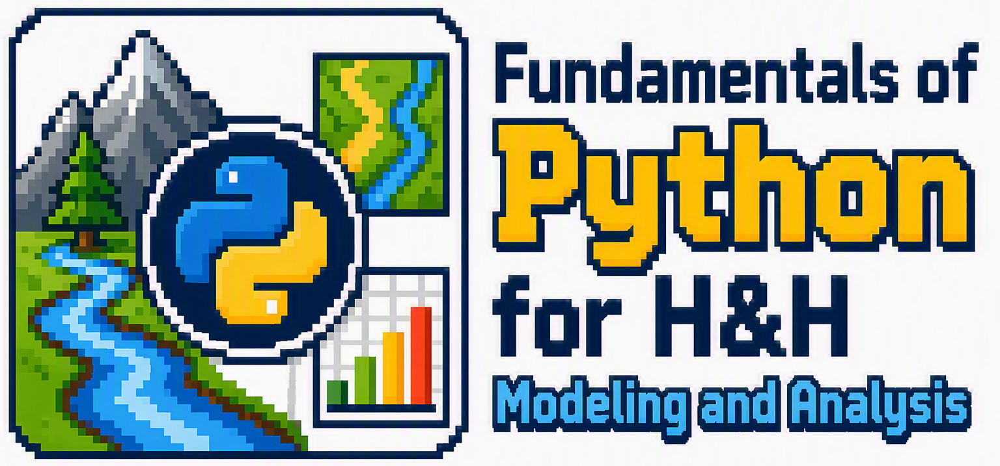
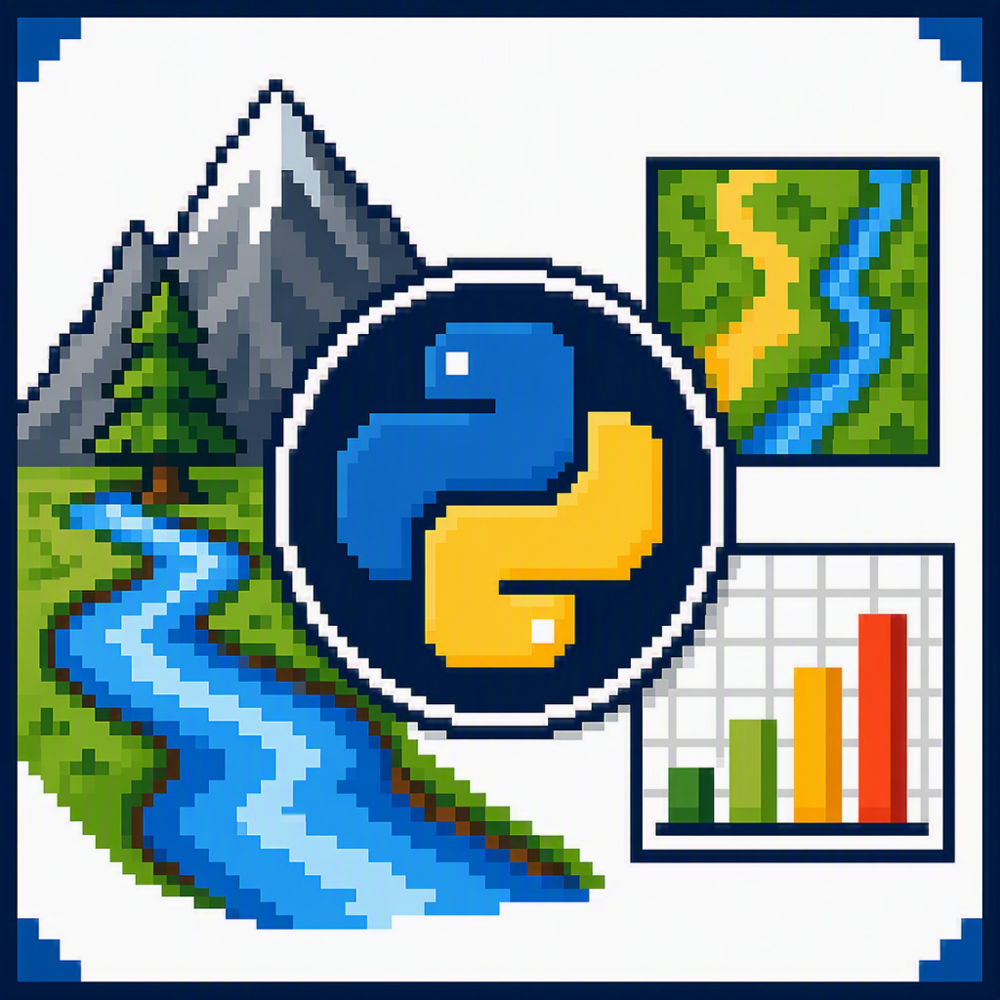

<p align="center">
  
</p>

<h1 align="center">Fundamentals of Python for H&amp;H Modeling and Analysis</h1>

<p align="center">
  A practical Python course for water resources engineers
</p>

<p align="center">
  
  
  
  
</p>

<p align="center">
  <a href="https://hydromohsen.com/python_for_HH/">Course Website</a> &middot;
  <a href="#about">About</a> &middot;
  <a href="#course-modules">Modules</a> &middot;
  <a href="#getting-started">Getting Started</a> &middot;
  <a href="#more-hh-python-tools-to-explore">Tools</a> &middot;
  <a href="#contributing">Contributing</a> &middot;
  <a href="DATA_SHARING.md">Data Sharing</a> &middot;
  <a href="#license">License</a>
</p>

<table>
  <tr>
    <td width="104" align="center" valign="middle">
      <a href="https://hydromohsen.com/python_for_HH/">
        
      </a>
    </td>
    <td valign="middle">
      <strong>Interactive Course Website</strong><br>
      Browse all 10 modules with level filters, inspect Python workflow snippets, track completed notebooks, and explore the watershed runoff hydrograph at <a href="https://hydromohsen.com/python_for_HH/">hydromohsen.com/python_for_HH</a>.<br><br>
      <a href="https://hydromohsen.com/python_for_HH/"></a>
    </td>
  </tr>
</table>

---

## About

This course teaches Python programming fundamentals through real hydrologic and hydraulic engineering workflows. It is built for water resources professionals who already understand H&amp;H concepts and want practical scripting skills without becoming software engineers.

<table>
  <tr>
    <td width="33%" valign="top">
      <strong>Real-World Focus</strong><br><br>
      Every lesson works through daily H&amp;H tasks including time series, spatial vector and raster layers, stream gage records, precipitation datasets, soils, land cover, aerial imagery, and snowpack grids.
    </td>
    <td width="33%" valign="top">
      <strong>Clarity Over Complexity</strong><br><br>
      The focus stays on clear, readable code that replaces spreadsheets, automates repetitive tasks, and builds reproducible analyses.
    </td>
    <td width="33%" valign="top">
      <strong>AI-Assisted Learning</strong><br><br>
      AI and large language models have changed how engineers write, read, and debug code. The course shows how to use these tools responsibly to explore unfamiliar libraries, troubleshoot workflows, and improve code quality while keeping engineering judgment and accountability.
    </td>
  </tr>
</table>

By the end of the course, you will feel comfortable using Python and modern LLM-assisted workflows as everyday tools for hydrologic and hydraulic modeling, data analysis, and engineering decision-making.

### A Note on Units

Many examples in this course use U.S. customary units alongside SI units to match USGS and NOAA datasets. For learners outside the United States, converting between unit systems as you work through the exercises strengthens both Python and engineering practice. More SI-based examples and case studies will be added as the course grows.

---

## Course Modules

<table>
  <thead>
    <tr>
      <th width="48" align="center">#</th>
      <th>Module</th>
      <th width="160">Level</th>
      <th width="220">Open in Google Colab</th>
    </tr>
  </thead>
  <tbody>
    <tr>
      <td align="center"><strong>1</strong></td>
      <td><a href="https://github.com/mohsennasab/python-fundamentals-hh/tree/main/notebooks/01_setup_and_fundamentals">Setup and Fundamentals</a></td>
      <td>Beginner</td>
      <td>
        Lesson 1 &nbsp;<a href="https://colab.research.google.com/github/mohsennasab/python-fundamentals-hh/blob/main/notebooks/01_setup_and_fundamentals/01_01_introduction_fundamentals.ipynb"></a><br>
        Lesson 2 &nbsp;<a href="https://colab.research.google.com/github/mohsennasab/python-fundamentals-hh/blob/main/notebooks/01_setup_and_fundamentals/01_02_python_fundamentals.ipynb"></a>
      </td>
    </tr>
    <tr>
      <td align="center"><strong>2</strong></td>
      <td><a href="https://github.com/mohsennasab/python-fundamentals-hh/tree/main/notebooks/02_timeseries">Time Series</a></td>
      <td>Beginner</td>
      <td>
        Lesson 1 &nbsp;<a href="https://colab.research.google.com/github/mohsennasab/python-fundamentals-hh/blob/main/notebooks/02_timeseries/02_01_TimeSeries_Basics.ipynb"></a>
      </td>
    </tr>
    <tr>
      <td align="center"><strong>3</strong></td>
      <td><a href="https://github.com/mohsennasab/python-fundamentals-hh/tree/main/notebooks/03_vector-data">Vector Data</a></td>
      <td>Beginner</td>
      <td>
        Lesson 1 &nbsp;<a href="https://colab.research.google.com/github/mohsennasab/python-fundamentals-hh/blob/main/notebooks/03_vector-data/03_01_introduction_to_vector_data.ipynb"></a>
      </td>
    </tr>
    <tr>
      <td align="center"><strong>4</strong></td>
      <td><a href="https://github.com/mohsennasab/python-fundamentals-hh/tree/main/notebooks/04_raster-data">Raster Data</a></td>
      <td>Beginner</td>
      <td>
        Lesson 1 &nbsp;<a href="https://colab.research.google.com/github/mohsennasab/python-fundamentals-hh/blob/main/notebooks/04_raster-data/Module4_RasterData.ipynb"></a>
      </td>
    </tr>
    <tr>
      <td align="center"><strong>5</strong></td>
      <td><a href="https://github.com/mohsennasab/python-fundamentals-hh/tree/main/notebooks/05_stream-data">Stream Data</a></td>
      <td>Beginner</td>
      <td>
        Lesson 1 &nbsp;<a href="https://colab.research.google.com/github/mohsennasab/python-fundamentals-hh/blob/main/notebooks/05_stream-data/Module5_USGSDataRetrieval.ipynb"></a>
      </td>
    </tr>
    <tr>
      <td align="center"><strong>6</strong></td>
      <td><a href="https://github.com/mohsennasab/python-fundamentals-hh/tree/main/notebooks/06_precip-data">Precipitation Data</a></td>
      <td>Beginner</td>
      <td>
        Lesson 1 &nbsp;<a href="https://colab.research.google.com/github/mohsennasab/python-fundamentals-hh/blob/main/notebooks/06_precip-data/Module6_PrecipitationData.ipynb"></a>
      </td>
    </tr>
    <tr>
      <td align="center"><strong>7</strong></td>
      <td><a href="https://github.com/mohsennasab/python-fundamentals-hh/tree/main/notebooks/07_soil-data">Soil Data</a></td>
      <td>Intermediate</td>
      <td>
        Lesson 1 &nbsp;<a href="https://colab.research.google.com/github/mohsennasab/python-fundamentals-hh/blob/main/notebooks/07_soil-data/07_01_soil_data_ssurgo.ipynb"></a><br>
        Lesson 2 &nbsp;<a href="https://colab.research.google.com/github/mohsennasab/python-fundamentals-hh/blob/main/notebooks/07_soil-data/07_02_soil_data_gnatsgo.ipynb"></a>
      </td>
    </tr>
    <tr>
      <td align="center"><strong>8</strong></td>
      <td><a href="https://github.com/mohsennasab/python-fundamentals-hh/tree/main/notebooks/08_landuse-data">Land Cover &amp; Impervious</a></td>
      <td>Intermediate</td>
      <td>
        Lesson 1 &nbsp;<a href="https://colab.research.google.com/github/mohsennasab/python-fundamentals-hh/blob/main/notebooks/08_landuse-data/08_01_land_cover_impervious.ipynb"></a>
      </td>
    </tr>
    <tr>
      <td align="center"><strong>9</strong></td>
      <td><a href="https://github.com/mohsennasab/python-fundamentals-hh/tree/main/notebooks/09_naip-imagery">NAIP Aerial Imagery &amp; Land Cover Classification</a></td>
      <td>Intermediate / Advanced</td>
      <td>
        Lesson 1 &nbsp;<a href="https://colab.research.google.com/github/mohsennasab/python-fundamentals-hh/blob/main/notebooks/09_naip-imagery/09_01_find_download_naip.ipynb"></a><br>
        Lesson 2 &nbsp;<a href="https://colab.research.google.com/github/mohsennasab/python-fundamentals-hh/blob/main/notebooks/09_naip-imagery/09_02_visualize_compare_naip.ipynb"></a><br>
        Lesson 3 &nbsp;<a href="https://colab.research.google.com/github/mohsennasab/python-fundamentals-hh/blob/main/notebooks/09_naip-imagery/09_03_classify_naip_landcover.ipynb"></a><br>
        Optional &nbsp;<a href="https://colab.research.google.com/github/mohsennasab/python-fundamentals-hh/blob/main/notebooks/09_naip-imagery/09_04_advanced_watershed_mosaic.ipynb"></a>
      </td>
    </tr>
    <tr>
      <td align="center"><strong>10</strong></td>
      <td><a href="https://github.com/mohsennasab/python-fundamentals-hh/tree/main/notebooks/10_snow-data">Snow Data (UA 800 m &amp; SNODAS)</a></td>
      <td>Intermediate</td>
      <td>
        Lesson 1 &nbsp;<a href="https://colab.research.google.com/github/mohsennasab/python-fundamentals-hh/blob/main/notebooks/10_snow-data/10_01_downloading_snow_data.ipynb"></a><br>
        Lesson 2 &nbsp;<a href="https://colab.research.google.com/github/mohsennasab/python-fundamentals-hh/blob/main/notebooks/10_snow-data/10_02_ua_snow_analysis_mapping.ipynb"></a><br>
        Lesson 3 &nbsp;<a href="https://colab.research.google.com/github/mohsennasab/python-fundamentals-hh/blob/main/notebooks/10_snow-data/10_03_snodas_snow_analysis_mapping.ipynb"></a>
      </td>
    </tr>
  </tbody>
</table>

| Level | Description |
|-------|-------------|
| **Beginner** | No prior Python experience needed. Concepts are explained from scratch with H&amp;H analogies. |
| **Intermediate** | Assumes comfort with Python basics (variables, loops, functions, pandas). Focuses on applied workflows. |
| **Advanced** | Assumes working knowledge of Python and H&amp;H modeling tools. Covers automation, optimization, or integration with professional software. |

More modules and lessons will be added to this course over time.

<details>
<summary>Repository structure</summary>

```text
python-fundamentals-hh/
├── figures/              # Course banner and pixel-art logos
├── notebooks/            # Interactive Colab notebooks
│   ├── 01_setup_and_fundamentals/
│   ├── 02_timeseries/
│   ├── 03_vector-data/
│   ├── 04_raster-data/
│   ├── 05_stream-data/
│   ├── 06_precip-data/
│   ├── 07_soil-data/
│   ├── 08_landuse-data/
│   ├── 09_naip-imagery/
│   └── 10_snow-data/
├── DATA_SHARING.md       # Public dataset guidelines for contributors
└── README.md
```

</details>

---

## Getting Started

<table>
  <tr>
    <td width="380" align="center" valign="middle">
      <a href="https://youtu.be/XCqIm18dVT4">
        
      </a>
    </td>
    <td valign="top">
      <strong><a href="https://youtu.be/XCqIm18dVT4">Watch the Getting Started Video</a></strong><br>
      <em>A short walkthrough showing how to use this repository, open notebooks in Google Colab, and follow the course structure.</em>
      <ol>
        <li>Open any notebook directly in Google Colab from the module table above, or clone this repository locally.</li>
        <li>Follow the Python environment setup in Module 1 if you plan to run notebooks on your computer.</li>
        <li>Work through the notebooks in order.</li>
      </ol>
    </td>
  </tr>
</table>

---

## What Participants Are Saying

> "As a complete beginner to Python/Google Colab, the course was approachable and could be completed successfully."

> "This is an excellent course for beginners, particularly by highlighting where and how AI can assist."

> "The progression through each part, lesson, and module is very clear. The use of structured analogies and AI assistant subheadings is effective."

> "This is a strong, discipline-focused introduction to scripting and automation. It also demonstrates practical examples for each data type commonly used."

> "Step-by-step examples followed by small exercises are very helpful. The streamflow retrieval exercise is especially useful."

Participants have also suggested directions for future modules, including GIS software integration (running Python tools inside QGIS), working with HDF5 data formats, and building reusable pipeline templates for probabilistic and simulation-based modeling. These ideas are shaping the roadmap for upcoming content.

---

## More H&H Python Tools to Explore

This course covers the fundamentals. The open-source H&amp;H community builds and maintains several libraries that extend well beyond these modules.

| Tool | Description |
|------|-------------|
| [HyRiver](https://github.com/hyriver/HyRiver) | Unified Python access to USGS, NHD, 3DEP, NLDAS, Daymet, NID, and more |
| [dataretrieval-python](https://github.com/DOI-USGS/dataretrieval-python) | Official USGS NWIS data retrieval library (used in Module 5) |
| [pysheds](https://github.com/mdbartos/pysheds) | Watershed delineation, flow accumulation, and stream networks from DEMs |
| [pyflwdir](https://github.com/Deltares/pyflwdir) | Flow direction, upstream area, and river network analysis from elevation grids |
| [SPOTPY](https://github.com/thouska/spotpy) | Calibration, sensitivity analysis, and uncertainty estimation for hydrologic models |
| [hydroeval](https://github.com/ThibHlln/hydroeval) | NSE, KGE, PBIAS, and other model performance metrics in one library |
| [Pastas](https://github.com/pastas/pastas) | Time series analysis of groundwater levels with stress models |
| [xclim](https://github.com/Ouranosinc/xclim) | Climate indicators and indices for precipitation, temperature, and droughts |
| [RAS Commander](https://github.com/gpt-cmdr/ras-commander) | Python automation and orchestration for HEC-RAS models |
| [xarray](https://github.com/pydata/xarray) | Labeled multidimensional arrays for NetCDF, GRIB, and gridded climate data |
| [hvplot](https://github.com/holoviz/hvplot) | Interactive hydrograph and spatial plots with one-line syntax over pandas and xarray |
| [noaa_coops](https://github.com/GClunies/noaa_coops) | NOAA CO-OPS tides, currents, and water level data retrieval |

To recommend another tool, open an issue or submit a pull request.

---

## Author

<table>
  <tr>
    <td width="55%" valign="middle">
      <strong>Mohsen Tahmasebi Nasab, PhD</strong><br>
      Water Resources Engineer<br><br>
      <a href="https://hydromohsen.com">hydromohsen.com</a> &middot;
      <a href="https://hydromohsen.com/python_for_HH/">Course Website</a> &middot;
      <a href="https://www.youtube.com/@HydroMohsen">YouTube Channel</a>
    </td>
    <td width="45%" align="center" valign="middle">
      Support this course and help keep new modules coming.<br><br>
      <a href="https://buymeacoffee.com/HydroMohsen">
        
      </a>
    </td>
  </tr>
</table>

---

## How This Course Was Reviewed

This course has been assembled and reviewed manually alongside AI-assisted tools including [Claude Code](https://www.anthropic.com/claude-code) to check code, refine explanations, verify workflows, and keep formatting consistent across modules. Every change is reviewed by the author before publication.

Because Python geospatial libraries update over time, an example that runs cleanly today may need a small adjustment later. If you spot a broken cell or outdated link, please [open an issue](https://github.com/mohsennasab/python-fundamentals-hh/issues) so it can be fixed for the next learner.

AI assistants are also integrated into the learning workflow. Each module includes prompt callouts that invite learners to paste code into an assistant to ask for explanations, modifications, or debugging help while applying their own engineering judgment.

---

## Contributing

Contributions from practicing engineers and researchers are welcome.

1. Open an issue to propose your lesson idea before writing code.
2. Fork the repository and create your lesson in a feature branch.
3. Submit a pull request with your completed notebook.
4. Once reviewed and accepted, your module is published with your name listed as the contributor.

<details>
<summary>Module requirements, content standards, and review process</summary>

### Module Requirements

#### Notebook Structure

Each notebook includes these five sections at the top.

| Section | What to Include |
|---------|----------------|
| **Lesson Level** | Beginner, Intermediate, or Advanced (matching the table above) |
| **Purpose** | A short paragraph explaining why the lesson exists and where it fits in the course |
| **Learning Objectives** | A concise bullet list of skills learners gain by the end |
| **Prerequisites** | Prior modules or Python skills assumed |
| **AI Prompts** | Two to three practical AI prompts that help learners inspect, debug, or extend the code |

#### Content Standards

| Standard | Expectation |
|----------|-------------|
| Real H&amp;H examples | Relate every code example to hydrology, hydraulics, or water resources engineering. |
| Readable Python | Break compact one-liners into multi-line steps with comments for first-time Python users. |
| Sample data | Place required sample data in a `data/` subfolder inside your module directory, following the [Data Sharing Guidelines](DATA_SHARING.md) so nothing restricted or private is published publicly. |
| Google Colab tested | Verify the notebook runs from top to bottom in a fresh Colab session with only `pip install` dependencies. |
| AI-assisted prompts | Include copyable prompts for ChatGPT, Claude, Gemini, or Copilot showing how to verify and extend workflows. |
| Human tone | Explain steps plainly as you would to an engineering colleague. |

#### What Makes a Good Module Proposal

- Addresses a recurring H&amp;H workflow such as frequency analysis, rating curves, or flood mapping.
- Builds on skills from existing modules without duplicating them.
- Includes a public dataset learners can inspect and plot.
- Shows a clear "before and after" comparison between the manual workflow and the Python script.

#### Review Process

1. A maintainer reviews your pull request for technical correctness, clarity, and alignment with the standards above.
2. Feedback or small revisions may be requested during review.
3. Approved modules are merged with your name listed as the contributor.
4. Accepted contributions are published under the course license below.

</details>

---

## Disclaimer

This course, including its notebooks, code, datasets, and examples, is provided for educational purposes only. The software and data are provided "as is," without warranty of any kind. Always independently verify all inputs, assumptions, calculations, outputs, and interpretations before using them in analysis, modeling, design, regulatory submittals, operational decisions, or other professional applications. These materials are intended to support learning and should not replace engineering judgment, quality control, or project-specific review.

---

## License

This project is released under a custom license for personal educational use, with all rights not expressly granted reserved.

| You May | You May Not (Without Written Permission) |
|---|---|
| Use the materials for your own personal learning and self-study | Redistribute, republish, or mirror the materials |
| Contribute improvements back to this repository | Teach, present, or use the materials to instruct others, whether free or paid, online or in person |
| Link others to this repository or course website | Create adapted or derivative versions for distribution |
| | Sell, license, or monetize the materials, including monetized videos, online courses, and ad-supported tutorials |

This course is free for personal self-study. Any teaching, public presentation, redistribution, adaptation, or commercial use requires prior written permission, which can be requested at [hydromohsen.com](https://hydromohsen.com). Non-commercial educational requests are often approved when arranged in advance.

<details>
<summary>View Full License</summary>

```text
License for Personal Educational Use

Copyright (c) 2026 Mohsen Tahmasebi Nasab. All rights reserved.

Permission is hereby granted, free of charge, to any individual obtaining a
copy of these materials and associated documentation files (the "Course
Materials"), to access and use the Course Materials solely for that
individual's own personal, non-commercial learning and self-study, subject to
the following conditions. All rights not expressly granted here are reserved by
the copyright holder.

1. PERSONAL USE ONLY: The Course Materials may be used by individuals for their
   own self-study, personal skill development, and private educational
   purposes. This grant is personal to each user and is not transferable.

2. NO REDISTRIBUTION OR INSTRUCTIONAL USE WITHOUT PERMISSION: The Course
   Materials may not be redistributed, republished, mirrored, or used to
   teach, train, present to, or otherwise instruct any other person or group,
   whether free or paid, online or in person, without prior written permission
   from the copyright holder.

3. NO DERIVATIVE WORKS WITHOUT PERMISSION: Adapted, translated, or derivative
   versions of the Course Materials may not be created for distribution,
   publication, or presentation without prior written permission from the
   copyright holder.

4. NO COMMERCIAL USE: The Course Materials may not be sold, licensed, or used
   as part of any paid training program, commercial product, or for-profit
   service. This includes, without limitation, monetized video content, online
   courses, and ad-supported tutorials that reproduce or are derived from the
   Course Materials.

5. CONTRIBUTIONS: Submitting a contribution (such as a pull request) to this
   repository is permitted and encouraged. By doing so, you grant the copyright
   holder the right to use and publish your contribution as part of the Course
   Materials under these same license terms, with attribution to you as the
   contributor.

6. PERMISSIONS: Requests to teach with, adapt, redistribute, or otherwise use
   the Course Materials beyond personal self-study may be directed to the
   author at https://hydromohsen.com. Any such use requires written permission
   granted in advance, and where granted must credit the original author and
   link to the original repository at
   https://github.com/mohsennasab/python-fundamentals-hh

THE COURSE MATERIALS ARE PROVIDED "AS IS", WITHOUT WARRANTY OF ANY KIND,
EXPRESS OR IMPLIED, INCLUDING BUT NOT LIMITED TO THE WARRANTIES OF
MERCHANTABILITY, FITNESS FOR A PARTICULAR PURPOSE AND NONINFRINGEMENT. IN NO
EVENT SHALL THE AUTHORS OR COPYRIGHT HOLDERS BE LIABLE FOR ANY CLAIM, DAMAGES
OR OTHER LIABILITY, WHETHER IN AN ACTION OF CONTRACT, TORT OR OTHERWISE,
ARISING FROM, OUT OF OR IN CONNECTION WITH THE COURSE MATERIALS OR THE USE OR
OTHER DEALINGS IN THE COURSE MATERIALS.
```

</details>

---

<p align="center">
  <sub>Star this repository if you find it helpful.</sub>
</p>
